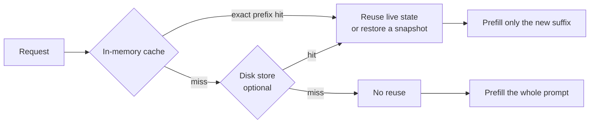
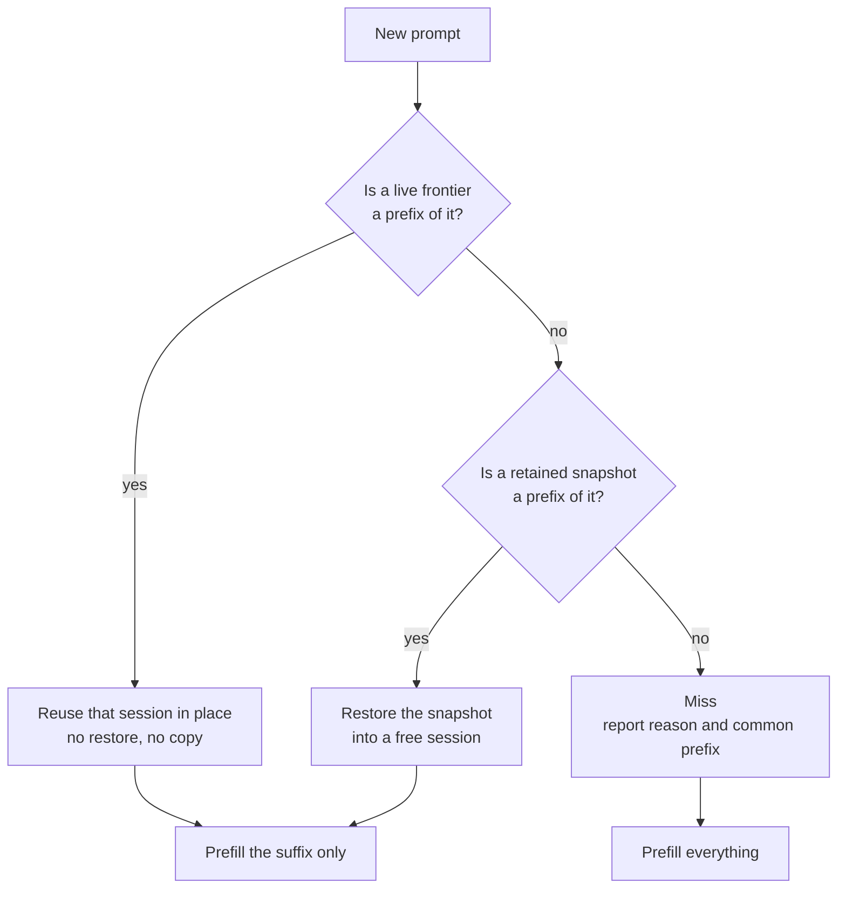
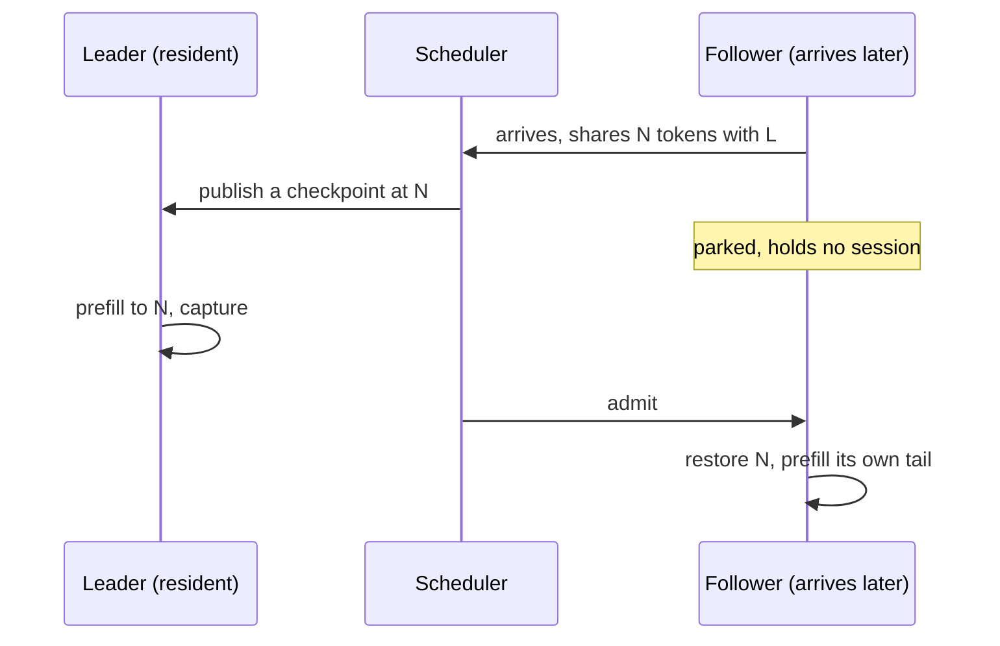

# KV Cache

## What "KV cache" means here

Two different things share the name. Keeping them apart avoids most of the
confusion.

**Within one request.** The standard transformer mechanism. Prefill computes
key and value tensors for every prompt token once; decode then appends one K/V
pair per generated token and attends over the stored set. Without it, each new
token would re-run attention across the whole sequence. This is intrinsic to
inference and is not configurable.

**Across requests.** Keeping that state alive after a response finishes, so
the next turn of the same conversation does not recompute the prefix it shares
with the previous one. This is what the rest of this document is about: the
`ContinuationCache`, and the optional on-disk tier behind `--cache-disk`.

The second is where the important subtlety lives. What Gufo retains is **not**
literally K/V tensors. It is an opaque snapshot owned by the model runner. For
Qwen3.8-27B that payload happens to be attention KV. For Qwen3.8-Flash-Next it
also contains GDN recurrent state, the indexer, position and sampling state.
The cache cannot inspect or interpret those bytes.

That choice buys one retention, admission, eviction and persistence mechanism
that is correct for every model, including hybrid-recurrent ones. It costs the
ability to trim a checkpoint: a saved snapshot can only be reused **whole**,
and only when its tokens are an exact prefix of the new prompt.

Qwen3.8-27B (AR and DFlash2) and Qwen3.8-Flash-Next serve through the
component cache of the [cache redesign](cache-redesign/RFC.md), which keeps
**no RAM checkpoints**: a request continues its session's live frontier, or
restores a disk checkpoint, or prefills cold. Without `--cache-disk` only live
frontiers are reused. See [component-cache budgets](#component-cache-budgets).
A checkpoint holds target KV, convolution and recurrent state, image identity,
sampled frontier and pending output tokens; DFlash2 adds private ring KV with
its own injected frontier, pending target features and draft controller state.
Every capture is a disk capture: completed KV rows are read from the session
(or from rows the device retains), while private states, partial tails and
rows the session cannot lend are first copied into bounded pinned host arenas.
Disk transfers use fixed 1 MiB staging regardless of checkpoint size.

The RAM snapshot cache described in the sections below (grid checkpoints, RAM
retention priorities, the 128-record pool, automatic RAM budget) remains in
use only for DeepSeek and other legacy runners. Earlier Qwen examples and
measurements describe that former implementation; they are historical
evidence, rather than qualification of the component path.

## Why it exists

Prefill cost scales with prompt length. Decode cost scales with tokens
generated. Agent conversations have a large prompt and a small output, and
turn *N*'s prompt is nearly all of turn *N−1*'s prompt. Without cross-request
reuse, every turn pays for the whole conversation again and total cost grows
quadratically with conversation length.

What reuse is worth, same conversation, second turn against a cold start
**(measured)**:

| Model | Prompt | Cold | Reused |
| --- | ---: | ---: | ---: |
| Qwen3.8-27B | 101,545 | 280.4 s | 2.4 s |
| Qwen3.8-Flash-Next | 203,047 | 184.4 s | 0.7 s |

A recorded 28-turn `pi` coding session reused 95.9% of its prompt tokens. The
same session replayed with reuse broken reprocessed 9.3x the tokens and took
2.5x the wall time, at only 15k tokens **(measured)**.

## The shape of the system



The in-memory tier is always on: live session frontiers for every runner,
plus retained RAM snapshots for legacy runners (DeepSeek). Qwen27B and
Flash-Next keep no RAM snapshots, so for them every checkpoint is on disk. The
disk tier is opt-in, adds restart safety, and can additionally *learn*
boundaries between conversations that merely share a prefix.

## Finding reuse

A request arrives with a token sequence. The cache looks for the longest
retained prefix of it, in two different forms.



A **live frontier** is where a session's state actually ended up after its last
request, including the tokens it generated. It is preferred even when a
snapshot matches the same length, because the state is already sitting there:
no restore and no device copy. This is why continuing the previous turn of a
conversation is nearly free, and why reuse can cover generated tokens and not
just prompt tokens. A request that continues no live frontier takes the least
recently used idle session (Flash-Next prefers one without a frontier), so
it does not replace the frontier of a conversation that has just replied.

A **snapshot** is an immutable retained checkpoint. Reusing one means restoring
it into a session, which costs a copy.

Both require an **exact prefix match**. The cache still computes the longest
common prefix on a miss and reports it, which is why a miss can say "we agreed
on 7,094 of your 7,103 tokens" and still re-prefill everything: it had no
checkpoint at that position to resume from.

### Worked example

A conversation with a 5,000-token system prompt, thinking off, client replaying
the assistant turn verbatim:

| Turn | Prompt | Reused | Prefilled | Why |
| --- | ---: | ---: | ---: | --- |
| 1 | 5,020 | 0 | 5,020 | nothing retained yet |
| 2 | 5,320 | 5,020 | 300 | live frontier from turn 1 |
| 3 | 5,620 | 5,320 | 300 | live frontier from turn 2 |

Now change one thing: edit the *last user message* of turn 3 and resend. The
first 5,320 tokens are byte-identical. The longest usable retained checkpoint
wins, which can be the previous turn's frontier. If the longest usable
checkpoint is instead the intermediate position at 4,096 tokens, that prefix
can be restored and only the suffix is prefilled. If earlier checkpoints have
been evicted or refused by the byte budget,
and all remaining checkpoints fall after the edit, reuse is impossible:

| Turn | Prompt | Reused | Prefilled | Common prefix |
| --- | ---: | ---: | ---: | ---: |
| 3', intermediate checkpoint retained | 5,620 | 4,096 | 1,524 | 5,599 |
| 3', no usable earlier checkpoint | 5,620 | 0 | 5,620 | 5,599 |

That gap between "common prefix" and "reused" is the signature of the
exact-prefix limitation. See #331.

## Concurrent requests sharing a prefix

Checkpoints help a request only once they exist. When several requests that
share a prefix arrive together, such as subagents started from one system
prompt or a retry sent before the first attempt returns, none of them finds a
checkpoint, and each would prefill the shared tokens again. Prefill runs one
request at a time, so the copies cost the sum of all prefills, and all
requests finish together at the end.

Instead, a cold request that shares a long prefix with a request already
prefilling it waits for that one:



1. On admission, the scheduler compares the new prompt with every resident
   request still prefilling and takes the longest exact token prefix with
   matching input identity.
2. It waits only when the shared prefix is at least 512 tokens longer than
   what the request could already restore, the resident request has not yet
   prefilled past that point, and the runner supports snapshots. A
   conversation continuing from its own retained turn therefore never waits
   for a newcomer that shares only its system prompt.
3. The resident request stops its prefill at the shared position and
   publishes a checkpoint there (Qwen27B and Flash-Next: a disk checkpoint;
   the follower waits for its publication). A
   checkpoint it already plans within 64 tokens is used instead. Identical
   prompts share up to the leader's last prompt token or its stable boundary.
4. The waiting request holds no session. Once the checkpoint is retained, or
   the leader passes the position, finishes or is cancelled, it is admitted
   ahead of newer requests and acquires its cache as usual.

Because requests are waiting for it, that checkpoint is retained with the
priority of a conversation's stable boundary: on a full cache it replaces the
least recently used checkpoint rather than being refused as an optional copy.
Waiting is still advisory, like admission: if the checkpoint does not fit at
all or the leader is cancelled, the request prefills by itself. A request
waits at most once, and at most `--sessions - 1` requests wait at a time. With
`--sessions 1` nothing waits, because a second request is never admitted
while the first prefills.

A short retry can arrive before its checkpoint reaches disk, including while
its source still decodes or settles cancellation. If a prompt of at most 4,096
tokens has no usable prefix and a compatible publication is already queued,
admission waits for that checkpoint. The wait is bounded by the smaller of two
seconds and the estimated saved prefill time, using two seconds when no timing
sample exists. For gains below 256 tokens, the estimate uses the nearest recent
first prefill step of a cold short prompt when available; warm suffixes and later
checkpoint tails do not calibrate it. This accounts for short-prefill overhead
that large-chunk throughput underestimates. Its deadline can shorten but never
extend. Publication failure,
cancellation or expiry releases the request; expiry is checked between scheduler
work units. Parked retries reserve admission capacity within that bound. Ordinary
warm requests keep the existing cost-bounded wait policy. This does not change
disk checkpoint spacing or restore a RAM checkpoint tier.

Measured on Flash-Next with `--sessions 4` and a 3.8k-token shared system
prompt, four concurrent requests took 13.4 s with each prefilling 3.9k tokens.
Prefilling the shared prefix once and restoring it took 4.6 s, each request
then prefilling 115 tokens **(measured)**. With a 242-token shared prefix the
gain was about 1 s of 9 s, which is why short prefixes do not wait.

## What gets retained

The unit of retention is a **checkpoint**, not a conversation. A single request
can retain up to four intermediate checkpoints in addition to its branching
fallback and complete prompt. Prefill stops at those positions and captures the
whole model state before advancing. Positions lie on a 2,048-token grid spread
across the prompt; the final grid point is within 2,048 tokens of its end.
Warm continuations skip grid positions less than 2,048 tokens beyond the reused
frontier, and every request skips grid positions within 128 tokens of its end:
such a point would split the final prefill pass for a checkpoint next to the
complete prompt. Capture runs asynchronously while that session is frozen, so other
requests can continue; a single execution slot skips the extra worker. A
request whose first token is already published decodes as soon as its capture
finishes, before the next bounded prefill chunk of a peer.
Where checkpoints keep KV as pool blocks a capture is cheap, so a warm
continuation does not stop at a stable boundary within 64 tokens of its reused
frontier: a second pass over the whole context would cost more than the few
tokens such a boundary saves, and the complete prompt is captured instead.
A cold assignment, or a pool reclaim, that would reset an idle slot first
writes its live frontier to disk when no checkpoint comes within 64 tokens of
it, so that conversation's next turn does not prefill its last reply again
(Qwen27B and Flash-Next, with `--cache-disk`). The state is copied into host
arenas while no other model work runs, so the slot is released at once; when
the arenas have no room the slot is held until the writer has read it. Logs:
`event=live_frontier_captured`, `event=live_frontier_capture_refused`; without
a disk cache the frontier is dropped, logged as `event=live_frontier_dropped`.
Coincident RAM and disk boundaries share one copy. Admission
remains subject to the existing byte budget, and intermediate copies preserve
the original branching fallback. These intermediate checkpoints live in RAM
and exist only for legacy runners: Qwen27B and Flash-Next take no grid or tail
checkpoints, and the disk tier retains prompt, learned shared-prefix and live
frontier boundaries.

### Learned divergence points

Grid checkpoints sit at fixed positions, not where conversations actually
diverge. Agents start many conversations with the same system prompt and tool
definitions, then a different task:

```text
Conversation 1:  [ shared 4,500 tokens ][ task A, 10,000 tokens ]
grid checkpoints:       ^2,048    ^6,144    ^10,240    ^14,336
```

Only the 2,048 checkpoint lies inside the shared part, so a second
conversation would restore 2,048 tokens and prefill the other 2,450 shared
tokens again. The longer the tasks, the further the grid spreads.

The point that matters, token 4,500, is unknown until a second prompt shows
where the two differ. When a request arrives, the cache compares it with the
tokens of every retained checkpoint and live frontier of the same input
identity. If the longest common prefix adds at least 512 tokens to what the
request can already restore, the request stops its prefill there and retains
an extra checkpoint. Other conversations depend on it, so it is retained like a
stable boundary, not as an optional copy, and the branch-point rule below keeps
it while it is shared. From the third conversation on, every new one restores
the whole shared prefix and prefills only its own task. A divergence within
the request's last 64 tokens, such as an edited final message, is covered by
its own stable checkpoint and takes no extra copy. The same position from the same prefix family is captured
once; records whose images differ from the prompt are not used to find it.
Without disk, this needs no configuration.

The system prompt is known without a second conversation. A request whose
leading system and developer messages reach 128 tokens also keeps a checkpoint
where they end: the first token at which its prompt and the same messages with
an empty user turn differ. It is retained like a learned divergence point
(on disk for Qwen27B and Flash-Next), so the first conversation under the same
system prompt restores it instead of a cold prefill.

Execution and retention have separate limits. `--sessions N` allocates N
mutable execution states and controls active request concurrency. A separate
pool holds **128 immutable checkpoint records**, regardless of session count.
These records allocate no extra execution states: with `--sessions 1`, several
inactive conversations can still be remembered.

This is a checkpoint limit, not a guaranteed conversation count. One history
can occupy several records, and the byte budget may bind before all 128 are
used. The server identifies related checkpoints by exact token prefixes and
matching input identities, not a client-supplied conversation ID.

When space is needed, RAM retention prefers removing:

1. A full-prompt retry copy with a stable fallback still retained.
2. An intermediate copy with a related stable continuation retained.
3. An older stable boundary covered by a newer one. A checkpoint that two
   retained conversations extend and then diverge after is the prefix they
   share, not an older turn, and never counts as covered.
4. Remaining checkpoints, oldest-used first within each priority.

Under entry pressure, an edited branch can first replace its incompatible
tail, preserving earlier shared checkpoints. Optional history/retry copies
are skipped rather than removing another prefix family's last useful copy.
Retry copies cannot displace earlier history or stable boundaries either.
An unchanged retry then restores the stable boundary and prefills only the
assistant opening, such as `<|im_start|>assistant\n<think>\n`, again. If
the prompt ends with a text-only user turn after a tool result or another user
turn, Qwen templates place the stable boundary before that turn, so the retry
prefills it too. The server logs `event=snapshot action=skipped` with that
prompt's length.
A new stable boundary can replace its own older boundary when that avoids
removing another family's last copy. Sources are rechecked before replacement
because another request may have changed the record.

The original resume point stays protected during intermediate/retry admission.
Earlier checkpoints remain best-effort: under pressure, edits and rewind may
need more prefill. Rotation beyond the actual memory or record capacity can
still lose reuse; this is not unlimited retention.

The actual selected limits are reported at startup:

```text
event=snapshot_cache_configured sessions=1 snapshot_entries=128 capacity_bytes=8589934592 automatic_bytes=8589934592 max_bytes=13958643712
```

## Invariants

These constraints are why several design choices are not preferences. Change
them deliberately or not at all.

**A checkpoint must contain the state at its exact token boundary.** Most
runners stop prefill at that boundary before capturing it. Flash-Next can
capture a text prompt's stable boundary within the final prefill pass: its
recurrent kernels retain the boundary state, convolution and PLE retain their
history, and a one-row head computes the boundary logits. Attention queries
on either side keep the grouping of separate passes. The final batch can
include up to 128 tokens beyond the normal 2,048-token chunk, so a prompt that
ends just past a chunk needs no separate tail pass; the stable boundary must be
within eleven tokens of that batch's end (an eight-token assistant suffix plus
the up to three tokens a four-token-aligned boundary falls back).
The cache reserves the full payload before enabling this capture. Disk,
image, intermediate and learned-prefix checkpoints still stop prefill at
their boundary.

**The reused frontier must be frozen before prefill.** Prefill mutates the
leased state in place, so a frontier another request might branch from has to
be captured first.

Flash-Next copies its mutable recurrent, convolution and PLE state into
private device storage at capture; the small indexer-ring, draft-residual and
kept-row regions go directly into the host payload. Committed K/V and pooled
rows remain in the live session while it appends, without a K/V copy.
A same-session rewind allocates backing blocks for only the rows it would
overwrite and copies them once for checkpoints sharing those rows. Appending
allocates no K/V backing blocks. Restore keeps the still-live prefix without
a K/V upload.
Reset leaves append-only rows intact; the first write that would overwrite
them preserves pending checkpoints. Session destruction preserves remaining
rows before releasing device buffers. Byte readers assemble a complete
payload before export. Forks copy the live prefix directly between device
buffers, including detached rows in the shared backing blocks. When both
sessions branch from a shared checkpoint, restore retains their proven shared
rows and copies only the different suffix. Equal token histories alone do not
prove identical K/V, since prefill shapes can change rounding.
A private HIP pool shared by the executor's sessions allocates and releases
snapshot storage without synchronizing peer inference streams. Each fresh
allocation commits device pages, about 4.5 ms per 111 MB on gfx1151, so a
restore into a slot whose rows other checkpoints still borrow pays that cost
for the rows it protects. A retained
Flash-Next snapshot prefers its source execution slot when
that slot is available, avoiding a full-prefix copy for a rewritten turn.
A busy source never blocks a branch into another slot; other choices use LRU.
RAM admission charges the complete payload size, except KV chunks a Qwen27B
checkpoint keeps as references to paged KV blocks (`--kv-pool-bytes`): those
stay in the device pool, and only private state, partial tails and copied
chunks are charged as RAM. The disk byte format is unchanged. Captures intended for disk complete all device
copies before prefill resumes, so disk serialization does not introduce a
background K/V transfer during inference.

**Admission is advisory, never fatal.** A refused reservation or a failed
capture is a skipped optimisation. The request must still complete.

**Eviction cannot skip a victim.** If removing an entry fails, the eviction
loop stops rather than trying the next candidate, in both tiers **(source)**.

## Limits

Independent limits can each bind first. For legacy runners, payload memory is
allocated only when captured; RAM-retained snapshots and their captures in
progress share the RAM budget. Qwen27B and Flash-Next keep no RAM checkpoints
(see [component-cache budgets](#component-cache-budgets)).

| Limit | Default | Set by |
| --- | --- | --- |
| Retained snapshot bytes, RAM (legacy runners only) | smaller of 32 GiB and half the available host RAM | automatic, no option |
| RAM checkpoint records (legacy runners only) | 128, independent of `--sessions` | internal safety limit |
| Capture host arenas (Qwen27B, Flash-Next) | 4 GiB of pinned host memory, freed after 60 s unused | internal |
| Cache metadata (Qwen27B, Flash-Next) | 256 MiB plus 1/64 of the disk budget, plus what the sessions pinned | internal |
| Disk bytes | 8 GiB | `--cache-disk-bytes` |
| Disk staging bytes (DeepSeek; Qwen27B and Flash-Next reject the option) | smaller of `MemAvailable / 8` and the disk budget | `--cache-disk-staging-bytes` |
| Paged KV pool bytes, device (Qwen27B, FP16 attention KV) | every session's full context | `--kv-pool-bytes` |

Qwen27B sessions with FP16 attention KV share one device pool of 256-token
KV blocks instead of a full-context KV allocation each; this is always on
for that policy. The pool holds every session's full context (sessions ×
context, the memory full-context sessions would hold) unless
`--kv-pool-bytes N` sizes it, smaller to
overcommit or larger to retain more checkpoint blocks. A session maps blocks
as it writes; a request is admitted once the pool holds its prompt plus
`max_tokens`, counting the blocks a continued session already maps. While the
pool is short, idle sessions the prompt does not continue return their
blocks: empty slots first, then live frontiers, oldest first (an uncovered
one is written to disk first when there is a disk cache). Otherwise admission
waits for running requests. The pool must hold one full-context session; other
models refuse a nonzero value.

The legacy RAM budget below applies only to DeepSeek and other legacy
runners; it has no option. With a DFlash2 draft, the Qwen3.8-27B sessions pin
one prompt capture of about 400 MiB at startup, shared by every session,
reported as `slot_pinned_bytes`; the component-cache ledger keeps it charged.

Both are sampled after weights and execution states are allocated, then fixed
for the server run. Flash-Next and Qwen3.8-27B use half the available
host RAM, respecting container/cgroup limits. Inactive page cache, such as
recently read model files, counts as available because the kernel reclaims it
before failing an allocation. Dirty and writeback pages do not. 27B also clamps this to HIP's free
device memory. CPU and GPU allocations compete for the same physical RAM on
Strix Halo, so HIP's free-memory estimate alone is not enough.
For example, 44 GiB available at load gives a 22 GiB automatic RAM cache and
allows an explicit limit of up to 40 GiB, even when HIP reports more free
memory. Free CMA pages never count as available, but they do hold the 4 GiB
reserve an explicit limit leaves the host: the ceiling subtracts the larger
of `CmaFree` and 4 GiB, not both. Inside a cgroup limit the full 4 GiB
reserve still applies below that limit.
Memory that another process claims after startup is not subtracted; starting
other GPU servers first only accounts for what they hold at that moment.
The RAM payload budget excludes weights, execution states, token metadata,
disk staging and Qwen's separate CPU image-preprocessing cache (up to 128 MiB
of retained encoded/RGB vectors plus bounded metadata). It also excludes temporary
host buffers used to save checkpoints to disk; this is not a limit on total
server memory.

The 32 GiB automatic cap limits default growth on a lightly loaded machine.
It leaves room for several 27B histories: two 3.7 GB checkpoints per history
would consume about 30 GB for four conversations, before optional copies.
The 128-record safety limit bounds metadata and lookup work without requiring
more execution sessions. Neither guarantees a conversation count: roughly,
divide the byte budget by the retained checkpoint bytes per conversation.
For example, 8 GiB holds at most eight sets of two 512 MiB checkpoints, or
two sets of two 2 GiB checkpoints, before extra copies and in-flight captures.

Increasing context or sessions reduces the memory left after loading, and
with it both budgets, exactly when snapshots grow. On Flash-Next with
`--sessions 2` at 262144 context, 14.8 GB remained after loading: a 7.76 GB
automatic budget against 5.70 GB snapshots at 200k tokens, so only one deep
conversation stays retained **(measured)**. A newer conversation's stable
boundary then replaces the older one's checkpoint; only optional intermediate
and retry copies are refused. This is a hardware ratio, not a cache policy:
weights, execution states and the OS leave no more memory. To keep more deep
conversations:

- Run fewer `--sessions`: each Flash-Next session at 262144 context holds about
  6.3 GB of state that the cache can use instead.
- Add `--cache-disk` so checkpoints that leave RAM can still be restored from
  disk. DeepSeek also needs `--cache-disk-staging-bytes` above the
  snapshot size; Qwen27B and Flash-Next stream any size through their
  internal buffer and reject the option.

See #343.

Snapshot size scales with retained tokens and differs sharply between models:
roughly 0.5 GB at 5k tokens on Flash-Next, and 3.7 GB at 24k tokens on
Qwen3.8-27B **(measured)**. Automatic disk staging therefore has no fixed cap:
it follows available RAM and the disk budget, so `--cache-disk` keeps 27B
checkpoints at moderate depth without an explicit limit. See #259.

RAM eviction follows the checkpoint priorities above. Disk eviction remains
global least-recently-used, without conversation or rebuild-cost awareness.

### Component-cache budgets

Qwen27B and Flash-Next keep no RAM checkpoint tier. There is no
`--cache-ram-bytes` or `--cache-tail-checkpoints` option, no committed backing
pool and no RAM restore (`reuse` is `live`, `rewind`, `disk` or `none`). Reuse order is:

1. the session's live frontier, continued in place, or its rewind point
   (see [the disk tier](#the-disk-tier)), restored in place;
2. a disk checkpoint, restored through the 1 MiB staging buffer;
3. cold prefill.

Every capture (prompt end, stable and learned shared boundaries, idle
write-back, reassignment, pool reclaim) goes to the single disk writer.
Completed KV rows are lent from the session, or read from rows the device
retains, until the writer has read them. Private states (about 132 MB for a
Flash-Next checkpoint), partial tails and rows the session cannot lend are
copied first into pinned host arenas of 64 MiB (a larger piece takes its own),
at most 4 GiB in all, returned when written and freed after 60 s unused. A
capture that finds no arena room is held on its session until the writer reads
it (idle write-back, reassignment) or is skipped (`event=capture_staging_refused`).
A boundary within the disk step of an earlier checkpoint is not copied at all
(`event=capture_refused reason=min_step tokens=...`). This includes a complete
prompt just beyond its stable boundary: an unchanged retry restores that boundary
and prefills its mutable suffix, rather than requiring a second disk publication.
The functional checker requires that exact prompt-length refusal and keeps the
assistant-opening or independently counted user-suffix bound.

Cancellation after interrupted execution preserves queued captures before the
component lease resets the slot. Their observed prefix rows are read through
pinned views, which remain valid even if the execution state cannot be resumed;
no new live-state snapshot is taken. Preservation remains bounded by the existing
host snapshot arenas, and a capacity refusal can still leave the capture uncached.

The cache's host bookkeeping (index, histories, disk store and catalog,
publication scratch) is charged to a ledger that holds metadata only: 256 MiB
plus 1/64 of `--cache-disk-bytes`, plus what the sessions pinned at startup.
No cached payload competes for it. Disk staging (1 MiB plus up to 48 MiB of
device read-ahead) has its own limit.

A cache failure on the request path never fails a request: it leaves that
state uncached. Logs: `event=commit_failed` (release),
`event=capture_staging_refused`, `event=capture_refused`,
`event=persistence_refused`, `event=publication_untracked` (a written
checkpoint the index could not take; a restart finds it),
`event=live_frontier_unindexed` (the next turn restores from disk instead of
continuing in place).

| Option | Meaning |
| --- | --- |
| `--cache-disk-bytes` | Counts referenced, temporary and orphaned files. A lower budget at startup removes temporaries and orphans, then the oldest checkpoints by creation order: use history does not survive a restart. |
| `--cache-disk-staging-bytes` | Rejected: startup fails before any weights load. Disk transfers use an internal 1 MiB pinned buffer; checkpoints of any size stream through it. Its size did not change restore or write speed (#562), and a larger value only took pinned RAM and device heap. |
| `--cache-disk DIR` | Owned by one Qwen27B or Flash-Next server. A second one fails at startup, before its sessions allocate, with an ownership error naming the directory. Other models do not take this lock. Startup removes earlier-release `*.kvc` and `.tmp-*` files from the directory, including those of another model's server sharing it. |

The startup line `schema=component-cache-v1 event=configured` reports
`metadata_limit_bytes`, `staging_capacity_bytes`, `snapshot_capacity_bytes`
(the arena bound), `disk_capacity_bytes`, `disk_read_ahead_bytes` and
`slot_pinned_bytes`.

## The disk tier

`--cache-disk DIR` adds a second tier that survives restarts. A checkpoint
written before a restart restored a 24,866-token prompt in 1.8 s against about
50 s for a cold prefill **(measured)**.

A Flash-Next checkpoint is thousands of files: 157K tokens are 4.45 GB in
18,672 files, mostly 256 KiB. Helper threads warm the files ahead of the
restore, which still reads, checks and copies them in order. With four helpers
hinting the files, that restore took 1.3–1.4 s with the files on disk and
0.85 s from the page cache, against 8.7–9.9 s when one thread hinted each file
in turn **(measured, NVMe under dm-crypt)**. A hint still left the reader
waiting on almost every cold 512 KiB chunk file (0.65 GB/s); eight helpers
that read each file through a small buffer, up to 64 MiB ahead of the reader,
leave it in the page cache (4.1 GB/s) **(measured, host replay of a 16K
Qwen27B checkpoint)**.

It also **learns shared-prefix boundaries** that survive restarts. A
divergence point is learned from the second conversation (see above); in one
run of the former RAM-and-disk design the disk boundary became usable from the
fifth **(measured)**. See #267.

**Disk checkpoints are spaced at least 2048 tokens apart.** A conversation
advances a few hundred tokens per turn, so writing every turn serialises, fsyncs
and retains a nearly identical snapshot. A checkpoint less than 2048 tokens past
the longest stored entry that is still a prefix of it is skipped and logged as
`min_step`; legacy runners still retain it in RAM. Otherwise (and always on
Qwen27B and Flash-Next) the device state is not copied at all, so a skipped
checkpoint costs no capture time on the request path. Learned shared-prefix boundaries are
exempt, because they sit close to a deeper entry by construction. On a
Qwen3.8-27B functional run this cut disk writes from 31 to 5 and written bytes
from 6.97 GiB to 1.37 GiB **(measured)**.

The trade-off is what a disk-only restore resumes from. After a restart, or
once RAM evicted the conversation, a request restores the nearest stored entry
and re-prefills up to 2048 tokens plus its own turn, instead of resuming
exactly at the previous frontier. Greedy output is unchanged. Sampled output can
differ from the pre-restart response, because the re-prefilled gap follows
different chunk shapes, as with any partial hit. Continuation of a live
frontier is unaffected; idle write-back (below) keeps the last turn on disk.

**Idle and stopping sessions are written back.** With the component cache
(Qwen27B, Flash-Next), a session idle for the write-back delay whose live
frontier is 64 or more tokens past every disk checkpoint of its conversation
is written to disk while other sessions run, sharing the chunk files of
checkpoints its own execution already wrote. A slot reassigned to another
conversation, and the server at shutdown, write uncovered frontiers the same
way, so a restart resumes from the last turn rather than its prompt. A write
the queue refused is retried at shutdown; a failed one keeps the frontier
live in its slot. Logs: `event=live_frontier_written_back`,
`event=live_frontier_write_back_failed`.

**Rewind points keep a rewritten reply's turn reusable (Qwen27B and
Flash-Next).** A client that drops or discards reasoning sends each reply
back rendered differently from the tokens the model generated, so the next
prompt leaves the live frontier inside that reply. The recurrent state
cannot rewind, and the turn's stable boundary is usually within the disk step
of an earlier checkpoint, so before this each turn restored an older disk
checkpoint and prefilled up to one disk step again (plus a learned
checkpoint written one turn late). Now a request whose prompt repeats an idle
frontier through that frontier's stable boundary but not further, or that
was served from a rewind point, or that continues a slot already marked so,
stops prefill at its own aligned stable boundary and keeps that state on its
slot: completed KV rows the adapter retains in device storage (the slot's own
blocks, no copy), and host copies of private states, partial tails and rows
it cannot retain, in the snapshot arenas (all slots' points together at most
a quarter of them). Nothing is lent from the slot, so later execution leaves
the point intact. The next prompt that diverges after it restores the point
into the same slot (retained rows re-mapped, host pieces copied back): no
disk read, and the bytes are those a disk checkpoint of that boundary holds.
A rewind wins over an equally deep disk checkpoint and loses to a deeper live
frontier. The slot then starts a new execution branch, so queued writes of
the abandoned frontier never become its lineage. Clients that replay replies
verbatim never take a point and pay nothing. A stable boundary within 64
tokens of the reused one is still not a stop (`kNearbyStableTokens`), and
the first rewritten turn of a conversation, which reveals the client, still
restores from disk.

The point goes to disk (not limited by the disk step, shared ancestor chunks
reused) before its slot is reset: reassignment, row reclaim, a failed or
cancelled request, a disk restore into the slot. Idle write-back and
reassignment write a marked conversation's rewind point instead of its live
frontier, which no later prompt continues. A boundary the disk step allows
goes to disk at capture as well. Logs: `event=rewind_captured`,
`event=rewind_refused` (`reason=host_cap` or a snapshot-arena refusal),
`event=rewind_restored`, `event=restore_failed source=rewind`,
`event=rewind_persisted`, `event=rewind_persist_failed`, and
`event=acquire reuse=rewind`.

Disk entries are evicted by global LRU on last access, so one active run whose
checkpoints are all recent will displace every other conversation in age order
**(measured)**. See #275.

## What invalidates reuse

Anything that changes the token prefix. In practice:

- **Tool definitions** — adding, removing or reordering changes the prompt head
  and invalidates everything after it.
- **System prompt** — including anything volatile inside it, such as a
  timestamp or a working directory.
- **Response schema** — `response_format` is rendered into the prompt.
- **Images** — changing, removing or moving an earlier image invalidates
  checkpoints after it. Appending a new one does not.
- **Reasoning the client cannot replay** — thinking is on by default for Qwen
  and `reasoning_content` is not part of the OpenAI schema, so an ordinary
  client omits it when sending the conversation back. Gufo retains each turn's
  boundary before the assistant opening, so the next turn can reuse the prior
  history and process the rewritten assistant plus new input. That boundary
  must be saved on warm hits too; retaining only the old resume point caused
  cache reuse to stop advancing for the rest of the session. See #335. On
  Qwen27B and Flash-Next that boundary is a rewind point on the slot (see
  [the disk tier](#the-disk-tier)), so it is kept even within the disk step.

These do **not** invalidate reuse **(measured)**: changing `temperature`,
`top_p`, `seed`, `max_tokens`, penalties or `stop` between turns; streaming
versus not, which reuse identically and interoperate within one conversation.

`cache_prompt: false` on `/v1/chat/completions`, `/v1/responses`,
`/v1/completions` or `/completion` bypasses lookup for a single request. The
result can still populate the cache. `null` keeps the default, `true`.

`cache_persist: false` on the same endpoints keeps one request's checkpoints
in RAM only: nothing it captures is written or staged for the disk tier, so
they are lost on eviction or restart. It still reads disk checkpoints, and it
does not stop a later request without the flag from persisting the same
prefix. `null` keeps the default, `true`. Responses echo the applied value as
a top-level `cache_persist`; see [the server guide](SERVER.md).

## Observing it

| Log line | Meaning |
| --- | --- |
| `event=snapshot_cache_configured` | legacy runners: retained RAM capacity at startup, with the automatic budget |
| `schema=component-cache-v1 event=configured` | Qwen27B/Flash-Next: metadata limit, staging, capture-arena and disk budgets at startup |
| `schema=component-cache-v1 event=capture_staging_refused` | Qwen27B/Flash-Next: the capture arenas had no room for a capture's private state and tails; the capture is held on its session (`held_write=true`) or skipped |
| `event=commit_failed` | a cache failure at request release; the request succeeds and its state is not cached |
| `schema=component-cache-v1 event=publication_untracked` | a checkpoint was written but the index could not take it; it is found again at restart |
| `schema=component-cache-v1 event=live_frontier_unindexed` | a finished request's live frontier could not be indexed; its next turn restores from disk |
| `schema=component-cache-v1 event=disk_evicted reason=budget` | Flash-Next: startup removed the oldest checkpoints (creation order) to fit a lowered `--cache-disk-bytes` |
| `schema=component-cache-v1 event=disk_evicted reason=lru` | Qwen27B/Flash-Next: a publication evicted the least recently used checkpoint to stay inside `--cache-disk-bytes`: its `checkpoint_id`, `tokens`, `payload_bytes`, the store's `managed_bytes` afterwards against `capacity_bytes`, and the incoming checkpoint's `for_tokens` |
| `schema=component-cache-v1 event=disk_over_budget` | Flash-Next: the directory still exceeds `--cache-disk-bytes` after startup reclamation and eviction; publication is refused until it fits |
| `schema=component-cache-v1 event=published` | A checkpoint finished disk publication; `checkpoint_id` identifies the capture, `tokens` its boundary, and `purpose` is `prompt`, `generated`, `grid` or `learned`. Learned shared-prefix checkpoints bypass ordinary disk spacing and do not anchor it. Older logs without `purpose` are treated as non-learned by the spacing checker. |
| `schema=component-cache-v1 event=capture_refused reason=min_step` | A planned capture was skipped before copying because a compatible published or queued checkpoint anchors the disk spacing; `tokens` identifies the requested boundary. Learned captures are exempt. |
| `schema=component-cache-v1 event=rewind_captured` / `rewind_restored` / `rewind_persisted` | Qwen27B/Flash-Next: a request kept its stable boundary on its slot (`host_bytes`, `device_bytes`, `shared_pieces` reused from the slot's previous point), a rewritten reply's next turn restored it in place, or it was queued for disk before a reset (`reason`) |
| `schema=component-cache-v1 event=rewind_refused` | the rewind point did not fit its share of the snapshot arenas (`reason=host_cap`) or the arenas refused it; the next turn restores from disk |
| `schema=component-cache-v1 event=persistence_refused reason=min_step` | A captured checkpoint is too close to an existing publication; includes `checkpoint_id` and `tokens` |
| `event=snapshot action=removed reason=entry_capacity` | a retained prefix was evicted because every entry was taken |
| `event=snapshot action=skipped reason=entry_capacity` | no checkpoint record could be replaced safely for this capture |
| `event=snapshot action=skipped reason=byte_capacity` | legacy runners: a checkpoint did not fit the RAM budget |
| `event=disk_cache action=removed reason=lru` | legacy runners: a disk entry was evicted to stay inside `--cache-disk-bytes` |
| `event=disk_cache action=skipped reason=staging_capacity` | a checkpoint exceeded `--cache-disk-staging-bytes` and was never written |
| `event=disk_cache action=skipped reason=min_step` | a checkpoint was less than 2048 tokens past a stored prefix; RAM still retains it |

Per-request outcomes appear in the completion log and in `usage.gufo`:
`cache_hit`, `cache_miss_reason`, `cache_common_prefix_tokens`,
`cache_checkpoint_tokens`, `cache_restore_bytes`, `cache_restore_ms`,
`shared_prefix_wait_ms` (time spent waiting for a concurrent request, part of
`queue_ms`), plus
`prompt_n` (newly processed) and `cache_n` (reused) in the llama.cpp-compatible
`timings` object. Miss reasons are `no_checkpoint`, `prefix_changed`,
`input_changed` and `disabled`. Flash-Next reports `no_checkpoint` when no
stored prompt shares a token with the request and `no_compatible_boundary`
when one does but no restorable boundary covers it;
`cache_common_prefix_tokens` is then the longest agreement and
`cache_checkpoint_tokens` the deepest compatible boundary.

Flash-Next also reports `usage.gufo.component_cache.captured_checkpoint_ids`.
Match these request-local IDs to `checkpoint_id` in publication/refusal logs:
an earlier request's asynchronous write may finish after the current response.
IDs belong to one server lifetime; correlate each restart separately.

Reading them:

- `cache_n` growing turn over turn while `prompt_n` stays flat is healthy
  reuse.
- Concurrent requests with a shared prefix: one has `shared_prefix_wait_ms`
  zero and prefills the prefix; the others wait, then report the prefix in
  `cache_n` and only their own tail in `prompt_n`. With `--log-level debug`,
  `event=shared_prefix_wait` and `event=shared_prefix_ready` name the leader
  and position.
- `cache_n` **pinned** at the same value while `prompt_n` grows every turn is a
  checkpoint that stopped advancing. See #335.
- A large `cache_common_prefix_tokens` on a miss means a long prefix agreed and
  could not be resumed from: a mid-history edit, or an evicted checkpoint.

## Verifying changes

- `tests/functional/` covers rotation through independent conversations, a long
  history interrupted by tiny side requests, edits/rewind, advancing boundaries,
  cancellation and disk restart. Uncached controls check the answers; CPU tests
  exercise byte and record pressure without loading models.
- `tests/functional/continuation.py` covers cancellation, reasoning replay,
  images and restart persistence against a live server. After a restart,
  greedy and exact restores must reproduce their output; sampled restores may
  re-prefill less than one disk step.
- `tests/functional/cache_disk_spacing.py`, part of the `cache` suite, checks
  disk checkpoint spacing for a growing conversation, the restore after
  restart, and that a learned branch boundary is still written.
- `tests/functional/cache_concurrency.py` (`cache-concurrency`) sends
  identical prompts, shared-system fan-out with short and long tasks, short or
  no shared prefixes, a retained conversation beside a newcomer and a
  cancelled leader at once, checking waits, prefill work and uncached answers.
  `tests/cli/text_generation_scheduler_test.cpp` covers the same cases, plus
  runners without snapshots, without loading a model.
- `tests/cli/continuation_cache_test.cpp`,
  `tests/cli/continuation_disk_store_test.cpp` and
  `tests/cli/text_model_runner_test.cpp` cover retention, admission, eviction
  and the event sinks without loading a model.

## Known gaps

Tracked under #336, with the upstream reports #331, #335, #259, #267, #275,
#300 and #318.
