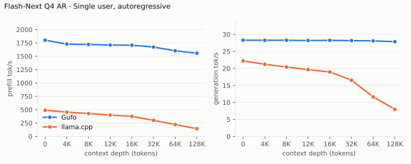
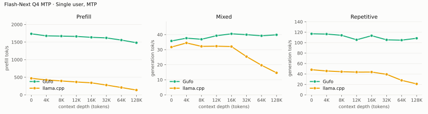
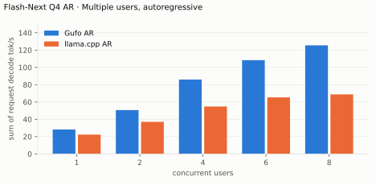
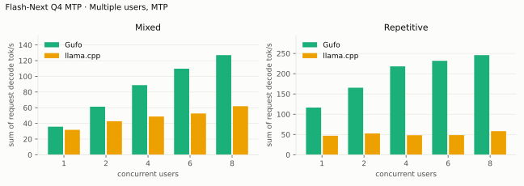
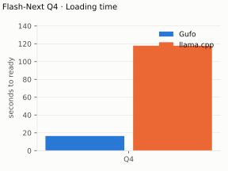
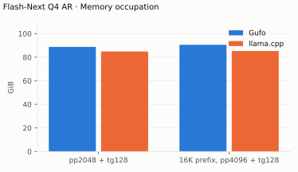

# Qwen3.8 Flash-Next benchmarks

## EXL3 shared-MoE/KVarN qualified batch, November 2, 2026

Current qualified image is `ai-tools/gufo-eval:f3-shared5-703d3e77-rocm101`
(`2184da9f…`), code `da1fd6a8`. Nix ROCm10.1, k4v4, speculative off,
temperature0, seed314159, r2; saved baseline reused.

| Case | Prior qualified tok/s | Current tok/s | Change |
|---|---:|---:|---:|
| pp512 | 1063.05 ±.22 | 1068.58 ±3.09 | +.52% |
| pp2048 | 1416.51 ±.82 | 1429.13 ±1.13 | +.89% |
| pp8192 | 1447.47 ±1.36 | 1460.97 ±.73 | +.93% |
| pp2048 at d32768 | 1291.03 ±1.09 | 1301.99 ±1.41 | +.85% |

[Qualification and exact scope](../../../plan/exl3/F3-STREAM-QUALIFICATION.json).
The later routed grouped-gate/up screen was not promoted and did not run a
model benchmark; these remain current. Goal2000 tok/s is unmet.

## EXL3 5.05 dense traversal follow-up, November 1, 2026

Earlier qualified image: `ai-tools/gufo-eval:f3-prefill3-67a50024-rocm101`
(`31fd777e…`). Nix ROCm10.1, KVarN k4v4, speculative off, temperature0,
seed314159, r2. Stored baselines reused; no new baseline inference.

| Case | Starting batch tok/s | Current tok/s | Change |
|---|---:|---:|---:|
| pp512 | 1061.85 ±.37 | 1063.05 ±.22 | +.11% |
| pp2048 | 1400.15 ±.83 | 1416.51 ±.82 | +1.17% |
| pp8192 | 1442.28 ±1.13 | 1447.47 ±1.36 | +.36% |
| pp2048 at d32768 | 1280.80 ±3.23 | 1291.03 ±1.09 | +.80% |

Only singleton K7 6144→2560 at2048 rows changes grid traversal. The actual
release object passed saved exact-output/guard comparisons. Batch512 model
collector evidence is reused because it cannot enter the new2048 predicate.
[Full scopes and qualification](../../../plan/exl3/F3-PREFILL-GRID.md).
The2000 tok/s goal remains unmet; earlier batches below are historical.

## EXL3 5.05 narrow dense/output-slice batch, November 1, 2026

Prior batch2 qualified prefill: Nix ROCm10.1, KVarN k4v4, speculative off,
temperature0, seed314159, r2. One candidate benchmark pass; prior saved
baseline reused. Accuracy payload remained exact. Goal2000 tok/s is unmet.

| Case | Prior batch tok/s | Current tok/s | Change |
|---|---:|---:|---:|
| pp512 | 1061.85 ±.37 | 1062.82 ±.08 | +.09% |
| pp2048 | 1400.15 ±.83 | 1405.25 ±.83 | +.36% |
| pp8192 | 1442.28 ±1.13 | 1446.11 ±1.33 | +.27% |
| pp2048 at d32768 | 1280.80 ±3.23 | 1282.89 ±2.18 | +.16% |

Image `ai-tools/gufo-eval:f3-prefill2-f497677d-rocm101-r1` (`d256d2ab…`).
[Qualification and scope](../../../plan/exl3/F3-PREFILL-BATCH2.md).
The earlier matrix screens below are historical; their narrow candidate is
now qualified in this batch. Completed TG/MTP work is retained.

## EXL3 5.05 prefill batch, November 1, 2026

Nix ROCm10.1, GCC16.2/Clang24, gfx1151; KVarN k4v4, speculative off,
temperature0, seed 314159. One candidate r2 window, saved pre-batch baseline reused.

| Prefill | Saved pre-batch (tok/s) | Candidate (tok/s) | Change |
|---|---:|---:|---:|
| pp512 | 1039.61 ± 0.73 | 1061.85 ± 0.37 | +2.14% |
| pp2048 | 1372.10 ± 0.11 | 1400.15 ± 0.83 | +2.04% |
| pp8192 | 1411.52 ± 1.17 | 1442.28 ± 1.13 | +2.18% |
| pp2048 @ d32768 | 1257.46 ± 0.39 | 1280.80 ± 3.23 | +1.86% |

`fn-prefill-batch-nix101` is healthy and complete. Contexts, prefill warmups and
case order match saved `fn-final-t1-x-ar-nix101`; generation cases were omitted.
These are observed batch-level gains; individual changes were not timed separately.
[Build and exactness evidence](../../../plan/exl3/F3-RESUME-RESULTS.md#qualified-prefill-batch-2026-11-01).

## Earlier GGUF benchmark suite

AMD Strix Halo `gfx1151`, 128 GB unified memory. Unsloth `UD-Q4_K_XL` target
with shared-Q8_0 MTP; adaptive drafting. HTTP, greedy, thinking off.
Gufo `fec4759d` (October 18, 2026); llama.cpp `b11069` AR and `6fcaa16f` MTP
(September 22–23). Positive gain favors Gufo.
[Quality and measurement details](QUALITY.md#benchmark-method) · [Model identities](artifacts/model-identities.json)

## Single user, autoregressive

Approximately pp2048 / tg128; depth is the cached prefix in tokens.
Context capacities differ between engines; see the measurement details.

<!-- bench:single-ar -->
| Flash-Next Q4 AR Depth (tokens) | Gufo pp (tok/s) | llama.cpp pp (tok/s) | Gain | Gufo tg (tok/s) | llama.cpp tg (tok/s) | Gain |
| ---: | ---: | ---: | ---: | ---: | ---: | ---: |
| 0 | 1801.01 | 489.59 | +267.9% | 28.29 | 22.20 | +27.4% |
| 4,096 | 1727.95 | 455.24 | +279.6% | 28.27 | 21.21 | +33.3% |
| 8,192 | 1721.41 | 428.85 | +301.4% | 28.27 | 20.40 | +38.6% |
| 12,288 | 1710.64 | 400.21 | +327.4% | 28.21 | 19.64 | +43.6% |
| 16,384 | 1706.86 | 375.89 | +354.1% | 28.25 | 18.95 | +49.1% |
| 32,768 | 1672.60 | 301.31 | +455.1% | 28.18 | 16.54 | +70.4% |
| 65,536 | 1602.93 | 221.94 | +622.2% | 28.09 | 11.62 | +141.7% |
| 131,072 | 1557.18 | 144.78 | +975.5% | 27.85 | 7.98 | +249.0% |
<!-- /bench -->

## Single user, MTP

pp is the highest measured rate per engine and depth across mixed/repetitive
text, including Gufo predictor catch-up.

<!-- bench:single-mtp -->
| Flash-Next Q4 MTP Depth (tokens) | Gufo pp (tok/s) | llama.cpp pp (tok/s) | Gain pp | Gufo tg mixed (tok/s) | llama.cpp tg mixed (tok/s) | Gain mixed | Gufo tg repetitive (tok/s) | llama.cpp tg repetitive (tok/s) | Gain repetitive |
| ---: | ---: | ---: | ---: | ---: | ---: | ---: | ---: | ---: | ---: |
| 0 | 1734.96 ± 0.85 | 468.76 | +270.1% | 35.79 | 31.73 | +12.8% | 116.93 ± 0.10 | 48.12 | +143.0% |
| 4,096 | 1676.83 ± 1.73 | 423.79 | +295.7% | 37.64 | 34.48 | +9.2% | 116.41 ± 0.07 | 45.71 | +154.7% |
| 8,192 | 1669.91 | 394.98 | +322.8% | 36.91 | 32.20 | +14.6% | 114.08 ± 0.01 | 44.31 | +157.5% |
| 12,288 | 1660.54 ± 1.22 | 365.91 | +353.8% | 39.28 | 32.32 | +21.5% | 105.48 ± 0.15 | 43.53 | +142.3% |
| 16,384 | 1635.18 | 341.98 | +378.2% | 40.54 | 32.07 | +26.4% | 113.32 ± 0.23 | 43.66 | +159.6% |
| 32,768 | 1618.63 | 277.61 | +483.1% | 39.97 | 25.41 | +57.3% | 105.38 ± 0.17 | 39.28 | +168.3% |
| 65,536 | 1556.32 | 208.04 | +648.1% | 39.23 | 19.65 | +99.6% | 104.78 ± 0.21 | 27.75 | +277.6% |
| 131,072 | 1481.19 | 135.42 | +993.8% | 39.87 | 14.63 | +172.5% | 108.37 | 20.96 | +417.0% |
<!-- /bench -->

## Multiple users, autoregressive

Same pp2048 prose prompt as single-user d0, tg128, context 4096 per user.
All sessions prefilled before timed decoding; throughput sums individual rates.
llama.cpp re-evaluates its four-token checkpoint tail.

<!-- bench:multi-ar -->
| Flash-Next Q4 AR Users | Gufo AR (tok/s) | llama.cpp AR (tok/s) | Gain |
| ---: | ---: | ---: | ---: |
| 1 | 28.24 | 22.34 | +26.4% |
| 2 | 50.66 | 37.08 | +36.6% |
| 4 | 86.01 | 54.82 | +56.9% |
| 6 | 108.34 | 65.34 | +65.8% |
| 8 | 125.48 | 68.79 | +82.4% |
<!-- /bench -->

## Multiple users, MTP

Same pp2048 mixed/repetitive prompts as single-user d0, tg128, context 4096
per user. All sessions prefilled before timed decoding; rates sum individual
request decode rates. C1 cross-checks the single-user table.

<!-- bench:multi-mtp -->
| Flash-Next Q4 MTP Users | Gufo mixed (tok/s) | llama.cpp mixed (tok/s) | Gain | Gufo repetitive (tok/s) | llama.cpp repetitive (tok/s) | Gain |
| ---: | ---: | ---: | ---: | ---: | ---: | ---: |
| 1 | 35.74 | 31.77 | +12.5% | 116.50 | 46.93 | +148.2% |
| 2 | 61.30 | 42.79 | +43.3% | 165.50 | 52.57 | +214.8% |
| 4 | 88.77 | 48.78 | +82.0% | 218.12 | 48.23 | +352.2% |
| 6 | 109.74 | 52.59 | +108.7% | 231.85 | 48.51 | +377.9% |
| 8 | 127.02 | 61.92 | +105.1% | 245.81 | 58.13 | +322.9% |
<!-- /bench -->

## Loading time

C1, context capacity 262144, MTP. Cold target/sidecar files to HTTP readiness.

<!-- bench:loading -->
| Flash-Next Q4 Target | Gufo ready (s) | llama.cpp ready (s) | Gain |
| --- | ---: | ---: | ---: |
| Q4 | 16.42 | 117.83 | +617.6% |
<!-- /bench -->

## Memory occupation

C1, context capacity 133121, AR. Peak memory reported by HIP.

<!-- bench:memory -->
| Flash-Next Q4 AR Workload | Gufo GiB | llama.cpp GiB | Gain |
| --- | ---: | ---: | ---: |
| pp2048 + tg128 | 88.78 | 84.84 | -4.4% |
| 16K prefix, pp4096 + tg128 | 90.53 | 85.31 | -5.8% |
<!-- /bench -->

